# Monitoreo IoT y Control Bidireccional con ESP32 & AWS

Sistema completo de Internet de las Cosas (IoT) basado en arquitectura serverles, permite visualizar en tiempo real datos de temperatura y humedad recolectados por un sensor DHT11 para el control de variables críticas  en las etapas de secado y almacenamiento de bioproductos de hoja de coca. Acciona actuadores (LED) de forma remota mediante un Dashboards web alojado en AWS.

## Integrantes
* Valentina Arciniegas
* Davinson Tulande
* Carlos Daza
* Andres Coral


## Tabla de Contenidos
 [1. Configuración de AWS IoT Core](#1-configuración-de-aws-iot-core)
   * [Creación del objeto (Thing)](#creación-del-objeto-thing)
 [2. Configuración ESP32](#2-configuración-esp32)
   * [Archivo de Configuración (config.h)](#archivo-de-configuración-configh)
   * [Lógica del Firmware y Publicación](#lógica-del-firmware-y-publicación)
 [3. Probar conexión MQTT](#3-probar-conexión-mqtt)
 [4. Base de datos DynamoDB](#4-base-de-datos-dynamodb)
   * [Creación de la tabla](#creación-de-la-tabla)
 [5. Reglas de enrutamiento](#5-reglas-de-enrutamiento)
   * [Observar valores de la tabla](#observar-valores-de-la-tabla)
 [6. Funciones Lambda y API Gateway](#6-funciones-lambda-y-api-gateway)
   * [Creación de Lambda Peticiones GET](#creación-de-lambda-peticiones-get)
   * [Creación de Lambda Peticiones POST](#creación-de-lambda-peticiones-post)
 [7. Dashboard S3 (Interfaz Web)](#7-dashboard-s3-interfaz-web)
   * [Componentes de la Interfaz](#componentes-de-la-interfaz)
   * [Consulta de datos de sensores (GET)](#consulta-de-datos-de-sensores)
   * [Control del actuador (POST)](#control-del-actuador)
   * [Exportación de datos a CSV](#exportación-de-datos-a-csv)


## Arquitectura
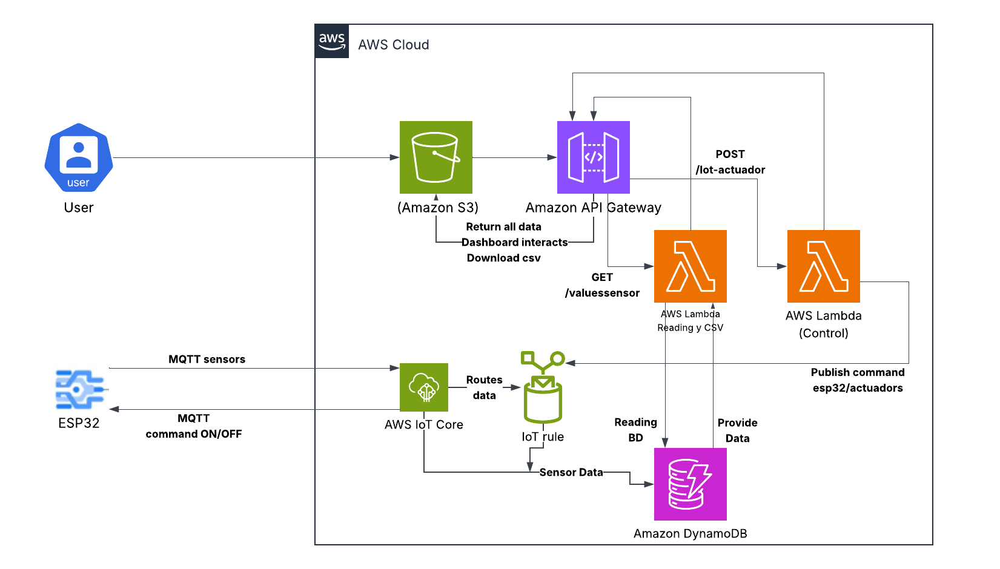

## 1. Configuración de AWS IoT Core

AWS IoT Core actúa como el *broker* MQTT central que permite la comunicación segura y bidireccional entre el ESP32, las funciones Lambda y el Dashboard Web.

### Creación del objeto (Thing)

Un objeto de IoT es una representación digital de su dispositivo físico en la nube, para crear un objeto se realiza le siguiente proceso:

1. Ir a la consola de `AWS IoT core `  > `Administrar ` >`todos los dispositivos ` > `Objetos `

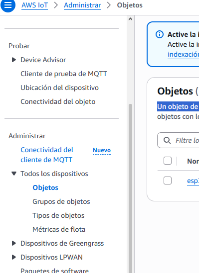

2. Se debe hacer click en la opción `crear objetos ` > `crear un único objeto`

3. En las propiedades del objeto se define el nombre del objeto ej: ` esp32-cocatrace` > siguiente

4. En la parte de certificados, seleccionar `Generar automáticamente un certificado nuevo`> siguiente

5. seleccionar la opción `crear politica`, se despliega una nueva ventana llamada `crear politica`

6. Se asigna un nombre de la política ej `esp32-cocatrace-policy`

7. Se deben asignar los documentos de política, indica de manera estructurada quién puede hacer qué, sobre qué recurso y bajo qué condiciones. En este caso el dispositivo esp32.
  
Se crea lo siguiente

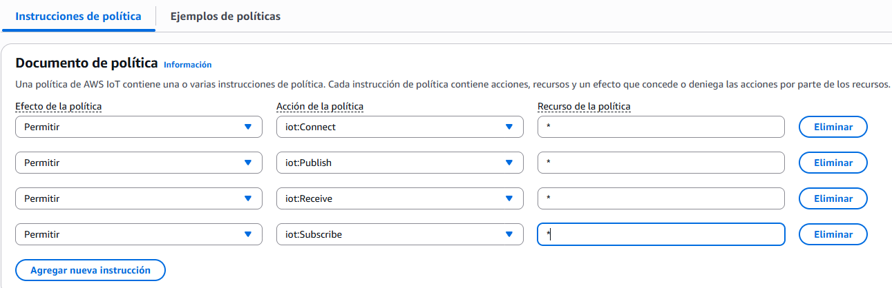

* las política sirven para otorgar permisos de conexión, publicación y suscripción al ESP32

* El uso * es para que estas políticas sirvan en cualquier recurso.

8.  Se crean las políticas > en la pestaña anterior se debe verificar que las políticas estén asociadas al objeto > se crea el objeto.

9. Se generan los certificados y claves, los certificados que se deben descargar son:
    
* **Certificado del dispositivo** (`xxxx-certificate.pem.crt`).
  
* **Clave privada** (`xxxx-private.pem.key`).
  
* **Certificado raíz de Amazon CA1** (`AmazonRootCA1.pem`).

Una vez creado el objeto > dar click al nombre del objeto > certificados > click en el nombre del certificado > políticas 

En caso de no tener políticas adjuntar política > buscar el nombre de la política creada

10. tambien se debe guardar el `end-point` este se ubica en

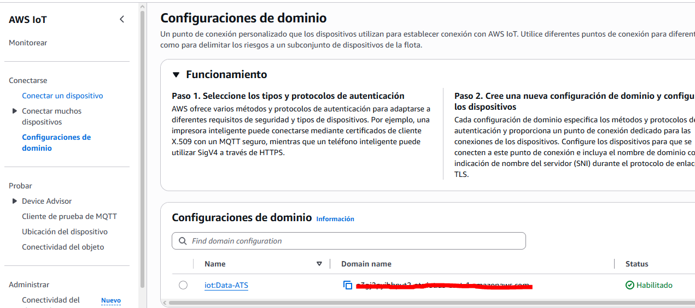

## 2. Configuración ESP32

El microcontrolador ESP32 está programado en C++ usando el framework de Arduino. Su función principal es leer los datos del sensor de temperatura y humedad (DHT11), sincronizar la hora local mediante un servidor NTP, transmite la información a la nube AWS mediante el protocolo MQTT/HTTPS y reacciona a las órdenes de control enviadas desde el Dashboards web.

Conexiones:

•	DHTPIN: Data conectada al GPIO 19.

•	VCC: 3.3V / 5V.

•	GND: Tierra común.

•	LED: GPIO 2 Conectado en serie con la resistencia de 220 Ω

**Tópicos MQTT:** 

* *Publicación (`esp32/values`):* Tópico donde el ESP32 envía la data cada 5 segundos.

* *Suscripción (`esp32/actuadores`):* Tópico donde el ESP32 escucha los comandos en tiempo real.

### Archivo de Configuración (config.h)

Se crea el archivo llamado `config.h` para las claves de red Wi-Fi y los certificados TLS X.509 de AWS IoT Core, en este archivo se debe incluir

1. Las variables de entorno para la red local (`WIFI_SSID`, `WIFI_PASSWORD`).

2. El **Endpoint de AWS IoT Core**, los tópicos MQTT y el contenido textual de los certificados descargados (`AmazonRootCA1.pem`, `xxxx-certificate.pem.crt` y `xxxx-private.pem.key`) utilizando la sintaxis `PROGMEM R"EOF(...)EOF"`.

Se puede observar más a detalle en `firmware/credentials.h`

### Lógica del Firmware y Publicación

El proyecto está diseñado bajo un modelo **bidireccional de dos vías**, separando el canal de recolección de telemetría (sensores) del canal de control remoto (actuadores).

* Enviar Datos

1. Inicializa el puerto serie a `9600` baudios, el sensor DHT11 y el pin del LED como salida. 
    
2. Llama a `conncetAWS()` para conectarse a la red y al *broker* MQTT.

3.  Configura la sincronización horaria mediante un servidor **NTP** (`pool.ntp.org`) ajustado a la zona horaria UTC-5 para obtener timestamps precisos.
   
4.  Establece la conexión Wi-Fi en modo estación (`WIFI_STA`). 

5. Asigna los certificados de seguridad TLS al cliente `espClient`.

6.  Configura el puerto seguro `8883`, la función *callback* para escuchar mensajes y amplía el buffer de MQTT a 512 bytes con `esp32.setBufferSize(512)` para evitar truncamiento de datos JSON.
     
7.  Intenta la conexión con un límite de 20 reintentos antes de marcar timeout y se suscribe a `esp32/actuadores`.
    
8.  Construye una estructura JSON dinámica en memoria usando `ArduinoJson` (`StaticJsonDocument<200>`) con el siguiente esquema:

```bash
json
 { "timestamp": 1793859932,
"id_sensor": "ESP32", "temperatura": 23.8, "humedad": 50.8,
"lote": "LOTE-2026-01", "proceso": "SECADO" }
```
* Callbacks desde AWS

Se usa `messageHandler(char* topic, byte* payload, unsigned int length) `, Actúa como función callback asíncrona cuando llega un mensaje desde AWS.
  
Se Deserializa el JSON entrante y extrae el valor de la clave `message`.
  
* Si message es "ON" $\rightarrow$ Conmuta digitalWrite(LED_PIN, HIGH).

* Si message es "OFF" $\rightarrow$ Conmuta digitalWrite(LED_PIN, LOW).

El codigo completo se puede observar en: `firmware/aws_esp32.ino`

## 3. Probar conexión MQTT

Para probar la conexión MQTT entre ESP32 y AWS Iot Core se debe hacer lo siguiente:

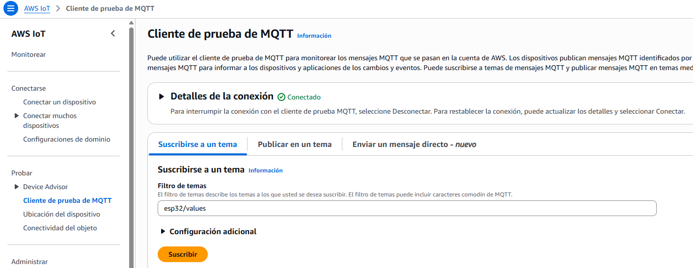

Se debe suscribir al mismo topic `esp32/values` que se suscribió el ESP32 para enviar los datos.

Los datos que se reciben se pueden observar en `Tema`.

# 4. Base de datos DynamoDB

Se utiliza como la base de datos NoSQL gestionada e independiente de servidores (*serverless*) para almacenar el historial de lecturas provenientes del sensor DHT11.

## Creación de la tabla

Para crear la tabla de almacenamiento se realiza le siguiente proceso:

1. Ir a la consola de `DinamoDB `  > `Tablas ` > `crear tabla `.

2. Se debe asigna el nombre de la tabla ej `valores-sensor-dht11`.
   
3. la clave de partición es el atributo principal que identifica a un elemento y determina en qué servidor o partición física de almacenamiento se guardan sus datos. Esta se configura de la siguiente manera:

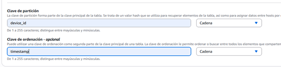

* **Clave de partición (Partition Key):** `device_id` (`String` / Cadena) :Actúa como el identificador único del dispositivo IoT (ej. `"ESP32"`). Se utiliza mediante una función hash para asignar físicamente los datos entre los distintos nodos de almacenamiento de AWS.
  
* **Clave de ordenación (Sort Key):** `timestamp` (`String` / Cadena) :Segunda parte de la clave principal compuesta. Permite registrar múltiples mediciones para un mismo `device_id` y ordenarlas o consultarlas cronológicamente.

Se crea la tabla

# 5 Reglas de enrutamiento

Para que los mensajes publicados por el ESP32 en el tópico `esp32/values` se almacenen automáticamente sin pasar por código intermedio se hace el siguiente proceso

1. Ir a la consola de  `AWS IoT core`> Enrutamiento de mensajes > Reglas > crear regla.
   
2. Se asigna nombre de la regla ej  `save_data_dynamodb`.
   
3. Se configura la instrucción SQL.

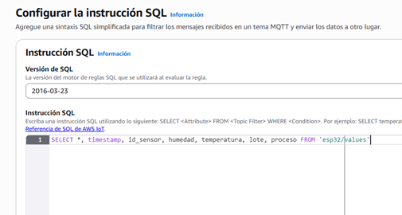

`FROM 'esp32/values':` Define el tópico MQTT origen que el motor de reglas escuchará en tiempo real.

`SELECT *:` Selecciona y extrae automáticamente todas las claves del payload JSON enviado por el microcontrolador.

`timestamp, id_sensor, `…: Mapea explícitamente los atributos de primer nivel para garantizar que estén disponibles para la acción de inserción en DynamoDB, permitiendo enlazar la Partition Key` (device_id / id_sensor`) y la Sort Key` (timestamp). `

4. luego se asigna las acciones de la regla a la regla creada

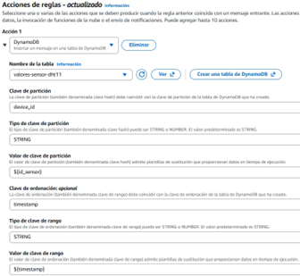

* `${id_sensor} ` *(Extrae en tiempo de ejecución el ID del dispositivo del payload procesado)*.
  
* `${timestamp}` *(Extrae la marca de tiempo UNIX o formateada enviada por el ESP32)*.

5. en Rol de IAM SE asigna  `LabRole` y se crea la tabla

## observar valores de la tabla

Para ver los registros guardados se hace el siguiente proceso:

1. En  la consola de `DinamoDB `  > explorar elementos.
   
2. se ubica el nombre de la tabla  > opción Examen > ejecutar.

# 5. Lambda

El backend de la aplicación utiliza funciones **AWS Lambda** escritas en Python 3.x para procesar las peticiones HTTP/REST provenientes del Dashboard web a través de **API Gateway**.

Lambda actúa como el procesador intermedio (el "cerebro" del backend) que conecta el Dashboard web alojado en S3 con los servicios de AWS (DynamoDB y AWS IoT Core).

## creación de lambda Peticiones GET

1. en la consola de `lambda `  > create event function

2. se asigna el nombre la función ej `iot-backend`

3. se elije la version ejecutable en este caso Python 3.13

4. En la opción de configuración personalizada > configuración adicional > se activa -rol de ejecución personalizada > labrole
   
5. se crea el `lambda `
    
6. se crea una nueva ventana con varias opciones > codigo
    
Se crea el codigo de la función lamba

Esta función Lambda actúa como la API de lectura (método `GET`) invocado por el Dashboard web.

* *Extracción:* Ejecuta un `scan()` sobre la tabla DynamoDB `valores-sensor-dht11`.
   
* *Parsing de Tipos (`DecimalEncoder`):* Adapta los valores numéricos de tipo `Decimal` propios de DynamoDB al formato estándar `float` de JSON.
   
* *Filtro Cronológico:* Ordena la telemetría según la clave `timestamp`, selecciona las 50 mediciones más recientes y las reordena cronológicamente (de antigua a reciente) para facilitar el renderizado lineal en **Chart.js**.

* *Respuesta CORS:* Retorna la lista en formato JSON con la cabecera `Access-Control-Allow-Origin: '*'` habilitada.

El codigo completo se puede observar en `src/lambda/iot-backend`

Se lanza el codigo en `prod`

## Agregar desencadenador

Se utiliza **Amazon API Gateway** para exponer una interfaz REST pública que permite al Dashboard web para consumir los datos guardados.

1. se da en la opción + agregar desencadenador, las opciones que se usan son:

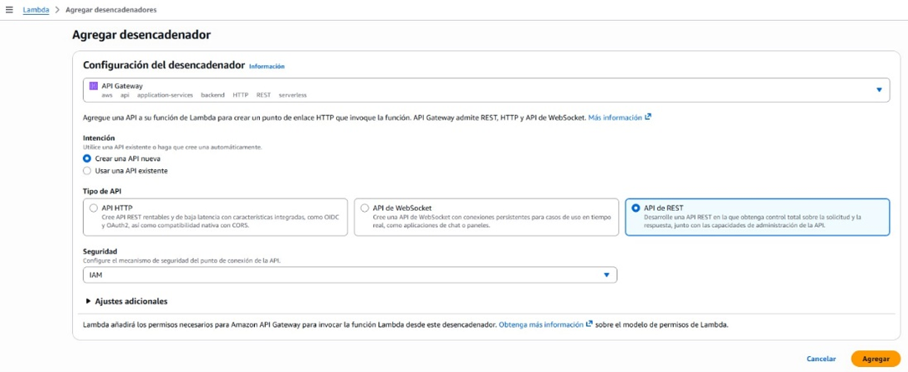

2.Luego se da a la opción agregar para activarla con la lambda anteriormente creado

3. en la consola de `Gateway de API` > crear recurso
   
4. se usan los siguientes detalles

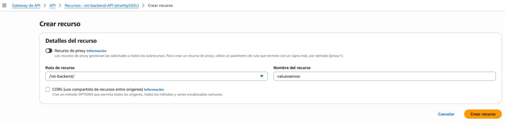

5. En la pestaña principal > crear método
   
6. tipo de método > GET > función de Lambda
   
7. se activa la opción `integración de proxy de lambda`
   
8. función de lambda > `iot-backend`> crear

En la pagina principal

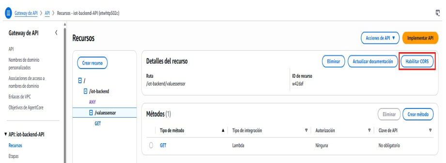

luego

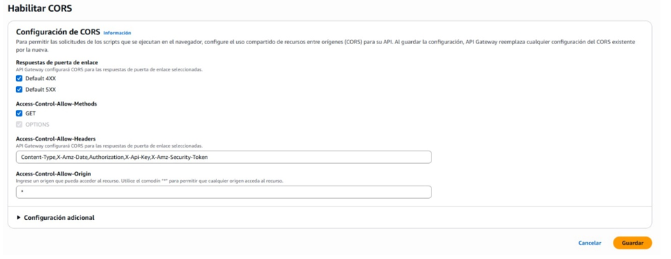

Luego se implementa el api en etapa `prod`

## Creación de lambda Peticiones POST

1. en la consola de `lambda ` > create event function

2. se asigna el nombre la función ej. `iot-actuador`
   
3. se elige la version ejecutable en este caso Python 3.13

4. En la opción de configuración personalizada > configuración adicional > se activa -rol de ejecución personalizada > labrole

5. se crea la lambda

6. se crea una nueva ventana con varias opciones > codigo

Se crea el codigo de la función lamba

Esta lambda Recibe la orden de encendido/apagado desde el Dashboard web y publicar un payload MQTT hacia el tópico esp32/actuadores de la siguiente manera

* Parseo seguro del cuerpo JSON enviado por API Gateway (soporta string y dict) body = json.loads(event.get('body', '{}')) if isinstance(event.get('body'), str) else event.get('body', {}) 

* Extracción de variables requeridas con valores de respaldo (fallback) estado = body.get('estado', 'OFF') device_id = body.get('device_id', 'ESP32') 

* Construcción del payload estructurado para el ESP32 (con epoch timestamp) mensaje = { "device_id": device_id, "message": estado, "timestamp": event.get('requestContext', {}).get('requestTimeEpoch', '') }

* Tópico MQTT de destino para actuadores topico_mqtt = "esp32/actuadores" 

*  Publicación del paquete en el broker MQTT de AWS IoT Core (QoS 1) iot_client.publish( topic=topico_mqtt, qos=1, payload=json.dumps(mensaje) ) 

* Respuesta HTTP 200 con cabeceras CORS activas para el navegador return { 'statusCode': 200, 'headers': { 'Content-Type': 'application/json', 'Access-Control-Allow-Origin': '*' }, 'body': json.dumps({'mensaje': f'Comando {estado} enviado exitosamente al topico {topico_mqtt}'}) } except Exception as e:

* Manejo de excepciones y registro de logs en CloudWatch print("Error al publicar en IoT Core:", str(e)) return { 'statusCode': 500, 'headers': { 'Content-Type': 'application/json', 'Access-Control-Allow-Origin': '*' }, 'body': json.dumps({'error': str(e)}) }

El codigo completo se puede observar en `src/lamda/iot-actuador`

Se lanza el codigo en `prod`

## Agregar desencadenador

1. se da en la opción + agregar desencadenador, las opciones que se usan son:

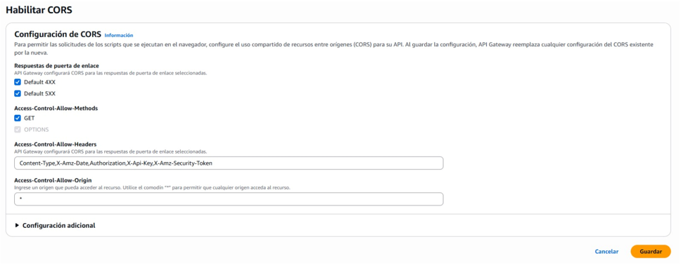

En este caso se usa el api existente

2. Se da a agregar
   
3. En la consola de `Gateway de API` > recursos
   
4. Se selecciona el recurso en este caso `iot-actuador` > crear método
   
5. Tipo de método > post > función de Lambda
   
7. Se activa la opción `integración de proxy de lambda`
   
9. Función de lambda > `iot-actuador`> crear
    
11. Se habilita CORS como en el anterior Lambda
    
Luego se implementa el api en etapa `prod`

# 6. Dashboards S3

Amazon S3 (Simple Storage Service) es el servicio de almacenamiento de objetos en la nube que ofrece AWS. Está diseñado para guardar y recuperar cualquier cantidad de datos desde cualquier lugar de Internet con alta disponibilidad, seguridad y durabilidad.

Para crear el bucket se realiza el siguiente proceso:

1. En la consola de `Amazon S3` > crear bucket
 
2. Se agrega el nombre del bucket ej `dashboard-iot-2026`
   
3.  Se concede acceso público a los buckets y objetos de la siguiente manera:

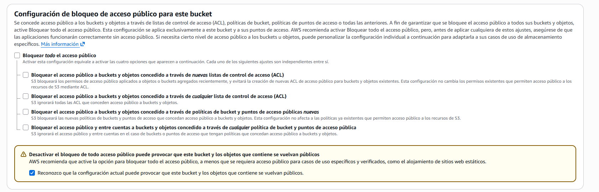
   
Se crea el bucket

4. Despues de crear el bucket > `propiedades`
   
5. Se configura`index.html` como documento índice de inicio de la siguiente manera

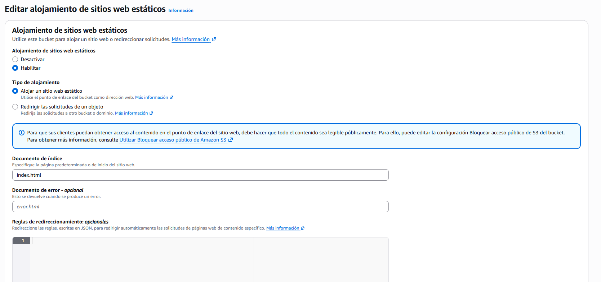

6. En `permisos` se realiza lo siguiente:

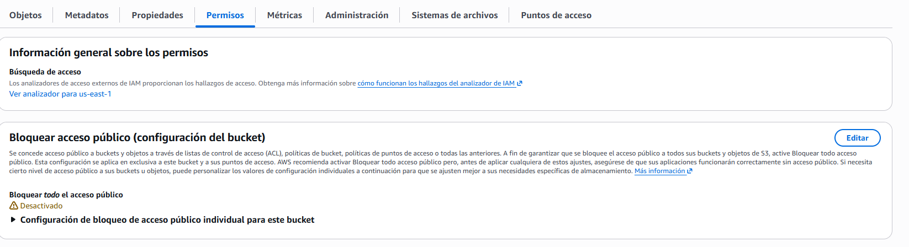

7. Se añade la siguiente politca de Bucket para permitir lectura pública

```bash
{
    "Version": "2012-10-17",
    "Statement": [
        {
            "Sid": "PublicReadGetObject",
            "Effect": "Allow",
            "Principal": "*",
            "Action": "s3:GetObject",
            "Resource": "arn:aws:s3:::tu-nombre-de-bucket/*"
        }
    ]
}

```

8. En `Objetos` se agrega `index.html`. este se explica a mas a detalle en la siguiente sección 


## Dashboard
El dashboard permite visualizar en tiempo real las mediciones obtenidas por un dispositivo IoT, consultar el historial de registros almacenados, representar gráficamente el comportamiento de las variables y enviar comandos para encender o apagar un actuador conectado al dispositivo. La comunicación entre la interfaz web y el sistema IoT se realiza mediante servicios API REST desplegados en AWS, utilizando peticiones HTTP GET para la consulta de datos y HTTP POST para el envío de comandos al actuador.

A continuación, se explica la estructura del dashboard:

### Tarjeta de temperatura

Presenta el valor más reciente de temperatura registrado por el sensor, expresado en grados Celsius. Además, muestra un gráfico de líneas que permite visualizar el comportamiento de las últimas 10 mediciones recibidas donde el eje horizontal muestra la hora de cada medición y el eje vertical representa los valores de temperatura.

### Tarjeta de humedad

Muestra el valor más reciente de humedad, expresado en porcentaje. Al igual que la tarjeta de temperatura, dispone de un gráfico dinámico que representa las últimas 10 mediciones recibidas donde el eje horizontal muestra la hora de cada medición y el eje vertical representa los valores de humedad.

### Control del actuador

Esta sección permite controlar remotamente un actuador LED conectado al dispositivo IoT. La interfaz dispone de dos botones:

* ENCENDER: envía un comando ON al servicio backend para solicitar el encendido del actuador.
* APAGAR: envía un comando OFF al servicio backend para solicitar el apagado del actuador.

La interfaz también dispone de un mensaje de estado que informa si el comando fue enviado correctamente o si se presentó algún error de comunicación.

### Historial de registros

Esta sección permite consultar los últimos 10 registros recibidos desde el backend. La tabla presenta la siguiente información: Fecha y Hora (momento en que se realizó la medición), Temperatura (valor de temperatura registrado), Humedad (Valor de humedad registrado) y Lote / Proceso	(identificación del lote y del proceso asociado a la medición).

También se evidencia un botón para descargar el historial completo de mediciones en formato CSV. El archivo generado contiene las siguientes columnas: Fecha y hora, Temperatura, Humedad, Lote y Proceso. El nombre del archivo incluye la fecha de descarga para facilitar su identificación.

### Consulta de datos de sensores

Se utiliza una petición HTTP GET para obtener los registros históricos de temperatura y humedad almacenados en el backend, mediante el endpoint:

```bash
https://etwhtp502c.execute-api.us-east-1.amazonaws.com/prod/iot-backend/valuessensor
```

La función `obtenerDatosSensor()` del script en index.html realiza las siguientes operaciones:

* Ejecuta una petición HTTP GET al endpoint configurado.
* Procesa la respuesta JSON recibida.
* Identifica y organiza los registros según su timestamp.
* Obtiene la última medición disponible.
* Actualiza los indicadores de temperatura y humedad.
* Actualiza los gráficos con las últimas 10 mediciones.
* Procesa el historial completo para permitir su exportación.
* Actualiza la tabla con los 10 registros más recientes.

La consulta se ejecuta automáticamente cada 5 segundos mediante la función setInterval().

### Control del actuador

Se utiliza una petición HTTP POST para enviar comandos de control al dispositivo IoT, mediante el endpoint:

```bash
https://etwhtp502c.execute-api.us-east-1.amazonaws.com/prod/iot-actuador
```

La función `enviarComando(estadoComando)` recibe como parámetro el estado solicitado (ON u OFF) y realiza la petición. El cuerpo de la solicitud contiene un JSON con los siguientes atributos:

* device_id: identificador del dispositivo IoT. En este proyecto se utiliza ESP32.
* estado: comando que indica si se debe encender o apagar el actuador.

La respuesta del servidor se utiliza para actualizar el mensaje de estado mostrado en la interfaz.

### Funcionamiento

El funcionamiento general del dashboard se desarrolla mediante el siguiente flujo:

* El dispositivo IoT realiza las mediciones de temperatura y humedad.
* Los datos son enviados y almacenados en la infraestructura backend (DynamoDB).
* El dashboard consulta periódicamente el servicio API mediante peticiones GET.
* El navegador recibe y procesa los registros en formato JSON.
* Los valores actuales se muestran en los indicadores principales.
* Los gráficos se actualizan para representar las últimas mediciones.
* El historial se presenta en una tabla y puede descargarse en formato CSV.
* Cuando el usuario selecciona ENCENDER o APAGAR, el dashboard envía una petición POST al backend.
* El backend procesa el comando para solicitar el cambio de estado del actuador conectado al ESP32.

Por último, se muestra una imagen del dashboard funcionando:

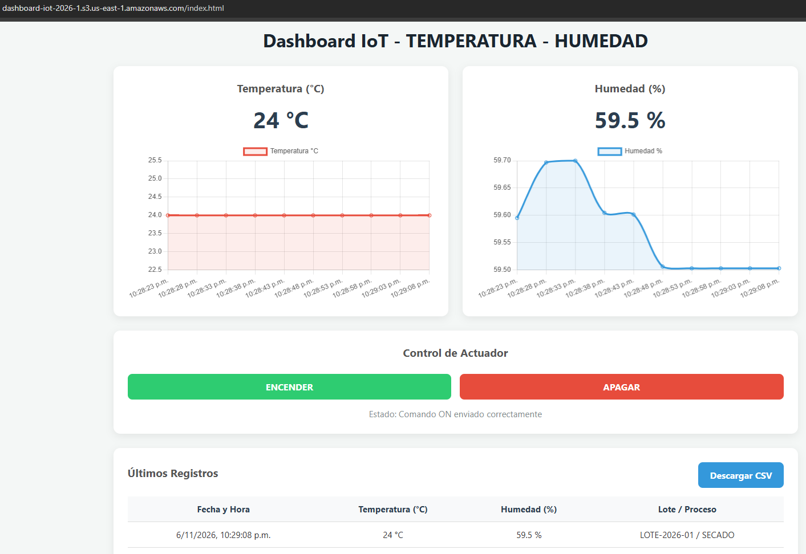
